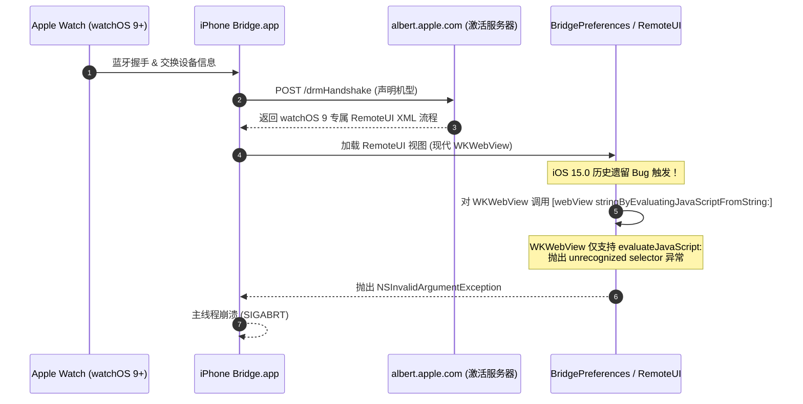

# iOS 15.0 配对 Apple Watch (watchOS 9+) 闪退排查与免越狱注入修复实录

> **测试环境**：
> - **iOS 设备**：iPhone（A12+ arm64e），系统 iOS 15.0
> - **环境状态**：TrollStore 巨魔环境（纯巨魔环境，未运行越狱守护进程）
> - **Apple Watch**：Apple Watch Series 8（Watch6,14），系统 watchOS 9.1
> - **辅助工具**：Legizmo Kincaid、TrollFools、Xcode 命令行工具链

---

## 一、故障现象与排查背景

在通过 iOS 15.0 系统的官方 **Watch（Bridge）** 应用配对运行 **watchOS 9+** 的 **Apple Watch** 时，配对流程在接近完成阶段（进入条款同意、诊断信息或手表设置渲染界面）**必定发生闪退**，导致配对中断并强制回滚（手表端退回欢迎星云表盘，手机端退出应用）。

即使设备已安装 Legizmo Kincaid（TrollStore 模式），依然会复现此崩溃。

---

## 二、诊断排查过程

### 1. 建立底层监控通道
为了捕获闪退瞬间的真实底层上下文，通过 USB 调试通道（`libimobiledevice`）对设备建立过滤日志监控：
- 使用 `idevicesyslog` 重点监听 `Bridge`、`nanoregistryd`、`pairedsyncd`、`BridgePreferences` 等进程；
- 精准收集配对通信与渲染事件。

### 2. 捕获崩溃现场日志（Crash Reports）
在复现闪退瞬间，抓取到崩溃转储（`.ips` 文件）：
- **崩溃进程**：`com.apple.Bridge`
- **崩溃信号**：`EXC_CRASH (SIGABRT)`
- **崩溃线程**：主线程 `com.apple.main-thread`

调用栈关键截断点：
```text
CoreFoundation: +[NSException raise:format:]
libobjc.A.dylib: objc_exception_throw
CoreFoundation: ___forwarding___
UIKitCore: -[NSObject(NSKeyValueCoding) doesNotRecognizeSelector:]
BridgePreferences + 81468
Bridge + 167060
RemoteUI + 152100 -> RemoteUI + 264840
```

### 3. 核心根因报错
系统 syslog 在崩溃瞬间捕获到了未捕获异常的明细原因：

```log
Bridge(CoreFoundation): -[WKWebView stringByEvaluatingJavaScriptFromString:]: unrecognized selector sent to instance 0x10389aa00
Bridge(CoreFoundation): *** Terminating app due to uncaught exception 'NSInvalidArgumentException', reason: '-[WKWebView stringByEvaluatingJavaScriptFromString:]: unrecognized selector sent to instance 0x10389aa00'
```

守护进程 `nanoregistryd` 检测到配对应用退出，触发事务回滚并断开连接：
```log
nanoregistryd: EPRoutingSlip: Rolling back saga entry
nanoregistryd: Sent IDS request willUnpairRequest to Watch
```

---

## 三、根本原因深度剖析



1. **历史遗留 API 错配 Bug**：
   - 在 iOS 15 中，负责展示远程配置页面的 `RemoteUI.framework` 升级为基于 WebKit 的 **`WKWebView`**。
   - 但是在 **iOS 15.0** 中，私有框架 **`BridgePreferences.framework`** 仍残留了早期基于 `UIWebView` 的同步方法调用 `stringByEvaluatingJavaScriptFromString:`。
2. **为什么配对高版本手表必现？**
   - 苹果激活服务器（`albert.apple.com`）下发给 watchOS 9+ 的描述文件包含新版条款与特性页面，触发了该脚本注入回调。
   - `WKWebView` 根本不存在此方法，消息转发失败，引发 `NSInvalidArgumentException`，导致主进程直接 `abort()`。
3. **为什么在纯 TrollStore 环境下需要额外处理？**
   - 纯 TrollStore 环境无全局 Substrate/ElleKit 守护进程，缺乏全局动态 hook 能力，系统调用直接穿透到了原生的 `WKWebView` 上。

---

## 四、技术修复方案实施

通过 Objective-C Runtime 为 `WKWebView` 扩展 Category，将同步调用安全转发给异步的 `evaluateJavaScript:`，返回空字符串，彻底消除 `unrecognized selector` 异常。

注入生效后重新配对，RemoteUI 页面渲染顺畅，顺利完成配对。
